# Secure 2-VM Network on Microsoft Azure

## Project Overview

This mini project demonstrates a secure two-virtual-machine network in Microsoft Azure. A Windows Server 2022 VM has a public IP address and acts as a **jump box**. An Ubuntu Linux VM is deployed without a public IP address and is reachable over SSH only from the Windows VM's private IP address.

The project demonstrates network segmentation, restricted administrative access, connectivity testing, and Terraform-based infrastructure management using `aztfexport`.

## Objectives

- Create an Azure resource group and a virtual network with two separate subnets.
- Deploy a Windows jump VM with a public IP address.
- Deploy a private Ubuntu Linux VM without a public IP address.
- Restrict RDP access to the Windows VM to an authorized client public IP.
- Allow SSH access to the Linux VM only from the Windows VM.
- Verify permitted and blocked connectivity paths.
- Use `aztfexport` to generate Terraform configuration from existing Azure resources and manage the imported networking resources.
- Delete the project infrastructure after testing to avoid unnecessary Azure credit usage.

## Architecture

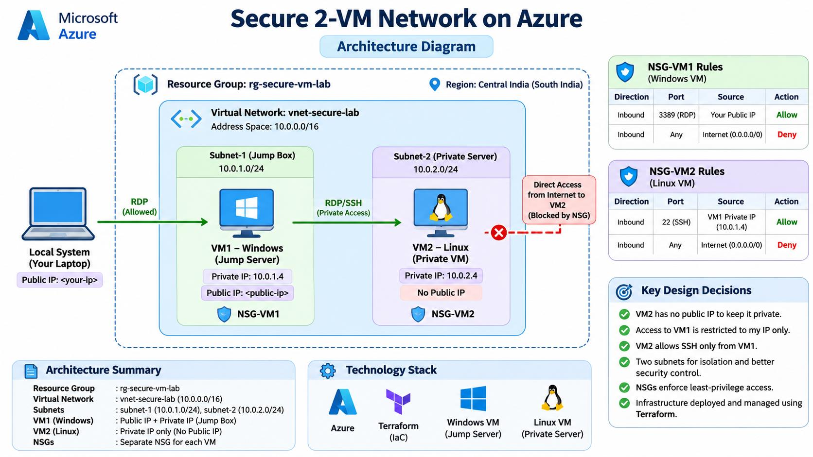

**Traffic flow**

1. The laptop connects to the Windows jump VM using RDP over TCP port `3389`.
2. From the Windows VM, an SSH connection is made to the Linux VM over TCP port `22`, using the Linux VM's private IP.
3. Direct laptop-to-Linux access is blocked. The Linux VM has no public IP and its NSG allows SSH only from the Windows VM's private IP.

## Azure Environment

| Resource | Configuration |
|---|---|
| Resource group | `rg-secure-vm-lab` |
| Region | Central India |
| Virtual network | `vnet-secure-vm-lab` |
| VNet address space | `10.0.0.0/16` |
| Windows subnet | `snet-windows` — `10.0.1.0/24` |
| Linux subnet | `snet-linux` — `10.0.2.0/24` |
| Windows NSG | `nsg-windows` |
| Linux NSG | `nsg-Linux` |
| Windows VM | `vm-windows-jump` — Windows Server 2022 |
| Windows private IP | `10.0.1.4` |
| Windows public IP | Assigned |
| Linux VM | `vm-linux-private` — Ubuntu Server 24.04 LTS |
| Linux private IP | `10.0.2.4` |
| Linux public IP | Not assigned |

### Resource group and network

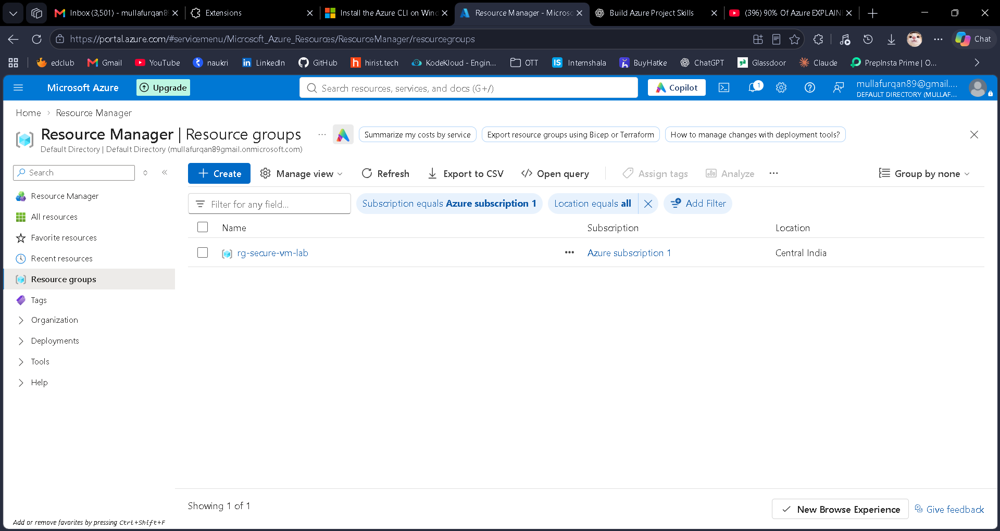

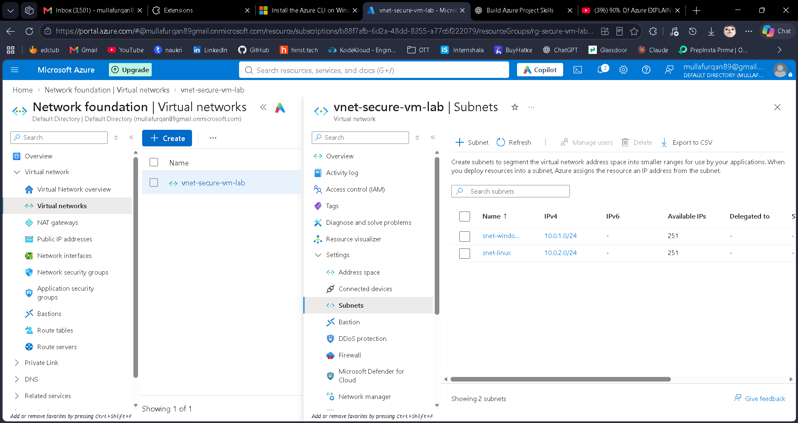

## Network Security Configuration

Two Network Security Groups (NSGs) control inbound access to the VMs.

### Windows NSG — `Allow-RDP-From-my-IP`

| Setting | Value |
|---|---|
| Protocol | TCP |
| Destination port | `3389` (RDP) |
| Source | `122.172.86.19` |
| Priority | `100` |
| Action | Allow |

This rule permits RDP access to the Windows VM from the authorized laptop public IP address recorded during the lab.

### Linux NSG — `Allow-SSH-From-Windows`

| Setting | Value |
|---|---|
| Protocol | TCP |
| Destination port | `22` (SSH) |
| Source | `10.0.1.4` (Windows VM private IP) |
| Priority | `100` |
| Action | Allow |

This rule permits SSH access to the Linux VM only from the Windows jump VM.

The subnet-to-NSG associations apply the relevant security rules to each subnet.

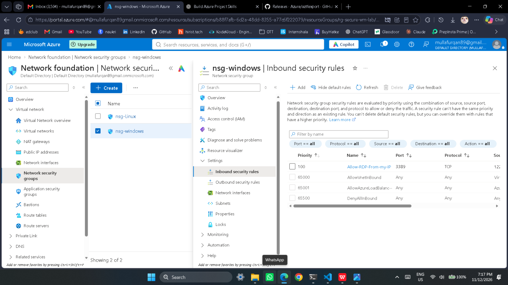

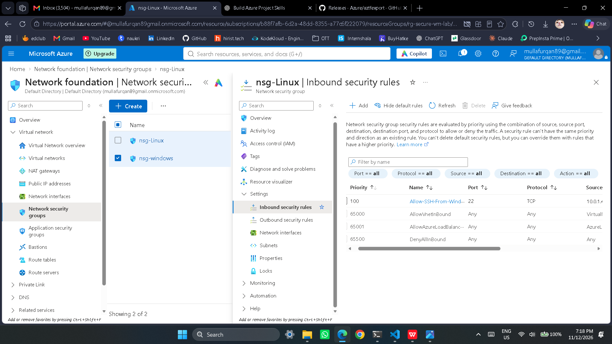

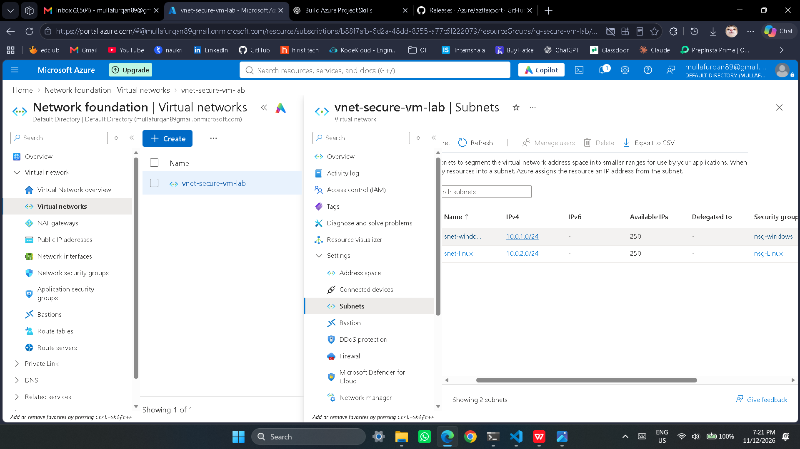

> **Security note:** The laptop public IP shown above is the value recorded in the project documentation. If reusing this configuration, replace it with the current authorized public IP. Do not expose credentials, private keys, or Terraform state files in the repository.

## Virtual Machines

### Windows Jump VM

The Windows Server 2022 VM was deployed in `snet-windows` with private IP `10.0.1.4` and a public IP address. It acts as the controlled entry point to the private Linux VM. RDP access on TCP port `3389` is restricted by the Windows NSG.

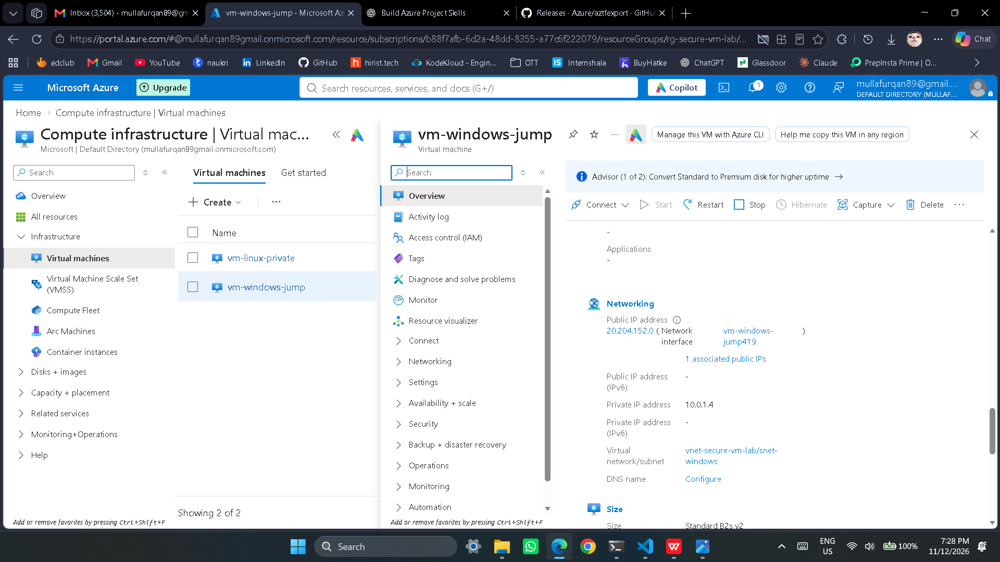

### Private Linux VM

The Ubuntu Server 24.04 LTS VM was deployed in `snet-linux` with private IP `10.0.2.4` and no public IP address. SSH access on TCP port `22` is allowed only from the Windows VM's private IP (`10.0.1.4`).

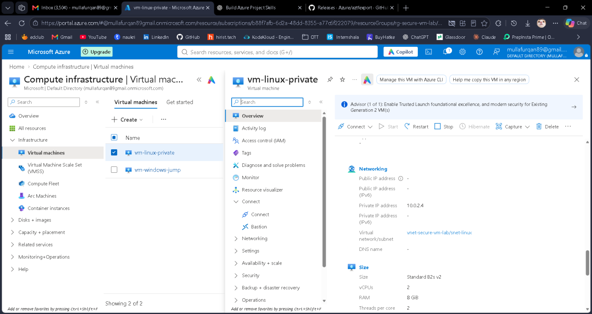

## Connectivity Verification

The following connectivity tests were recorded in the project documentation:

| Test | Expected/recorded result |
|---|---|
| Laptop to Windows VM using RDP | Successful |
| Windows VM to Linux VM using private SSH | Successful |
| Laptop directly to Linux VM | Blocked as expected |
| Another laptop to Windows VM | Blocked as expected |

### RDP: laptop to Windows VM

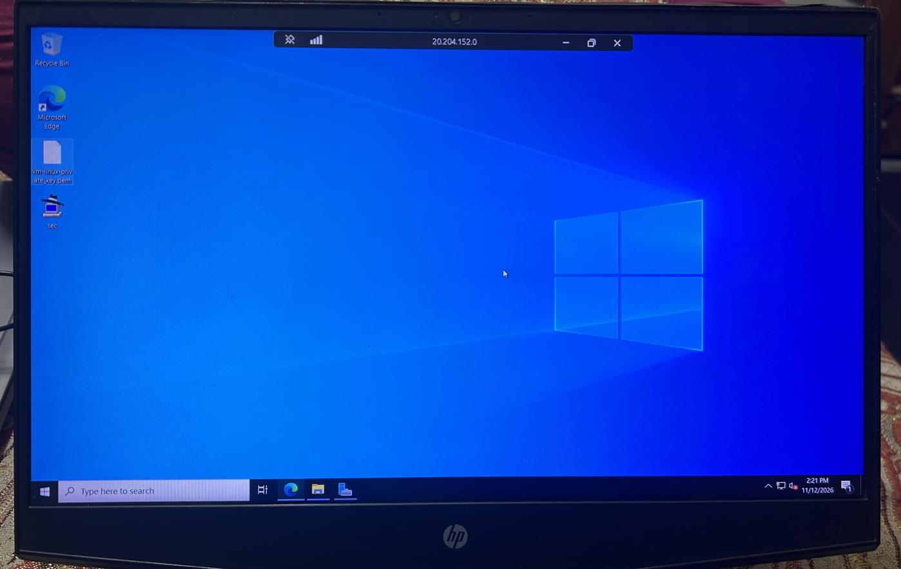

### SSH: Windows VM to Linux VM

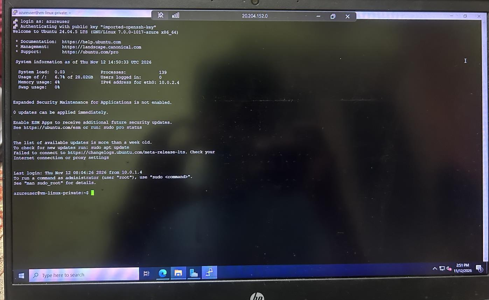

### Blocked access tests

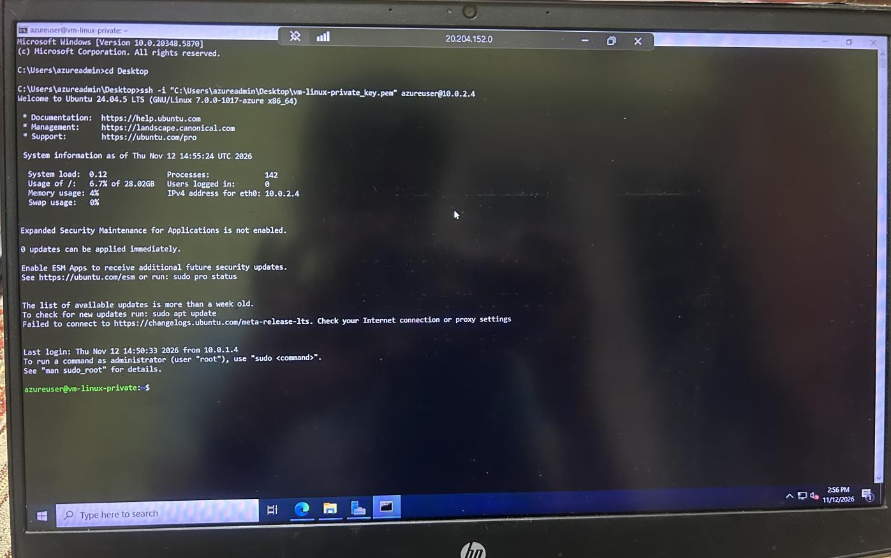

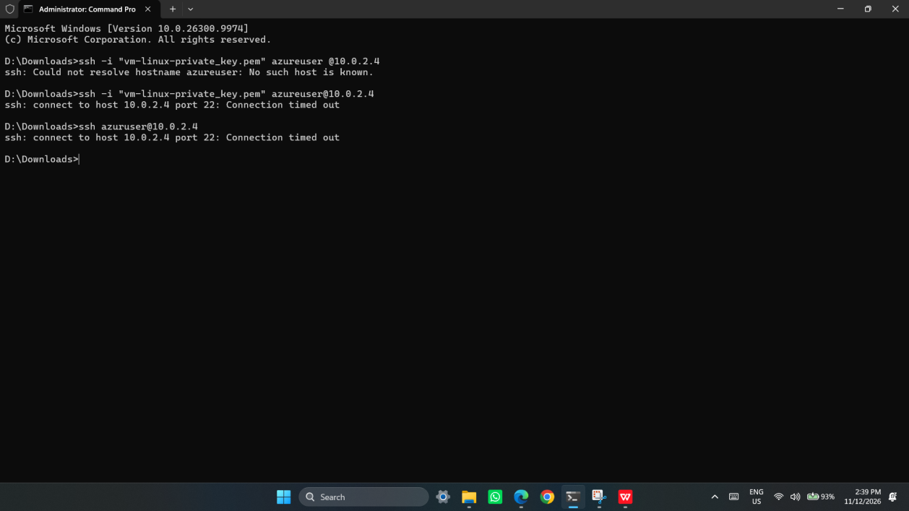

## Terraform Automation with aztfexport

The Azure infrastructure was initially created manually. `aztfexport` was then used to export existing Azure resources and generate Terraform configuration. The generated configuration was reviewed and modified to suit the project requirements.

The initial Terraform state import covered **eight networking resource instances**:

- 1 Resource Group
- 1 Virtual Network
- 2 Subnets
- 2 Network Security Groups
- 2 NSG security rules

Terraform commands used during the work included:

```bash
terraform init
terraform fmt
terraform validate
terraform plan
```

The Terraform configuration, state list, and plan were reviewed as part of the exercise.

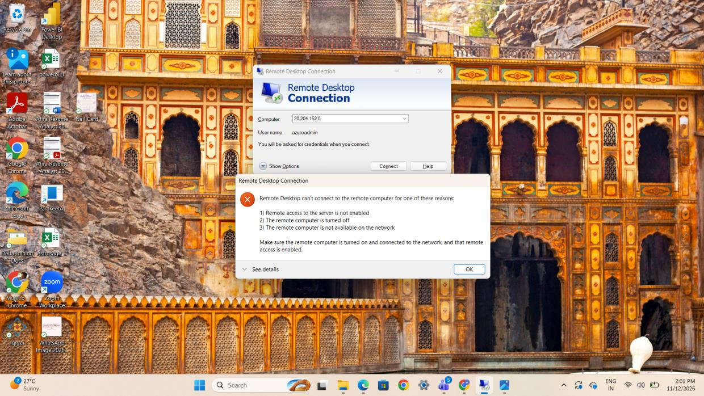

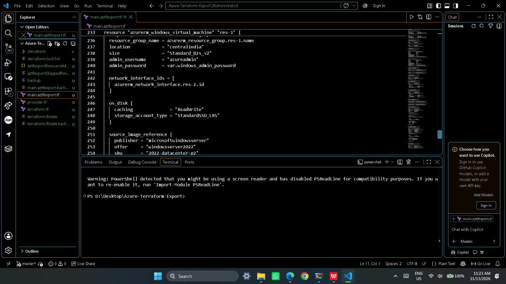

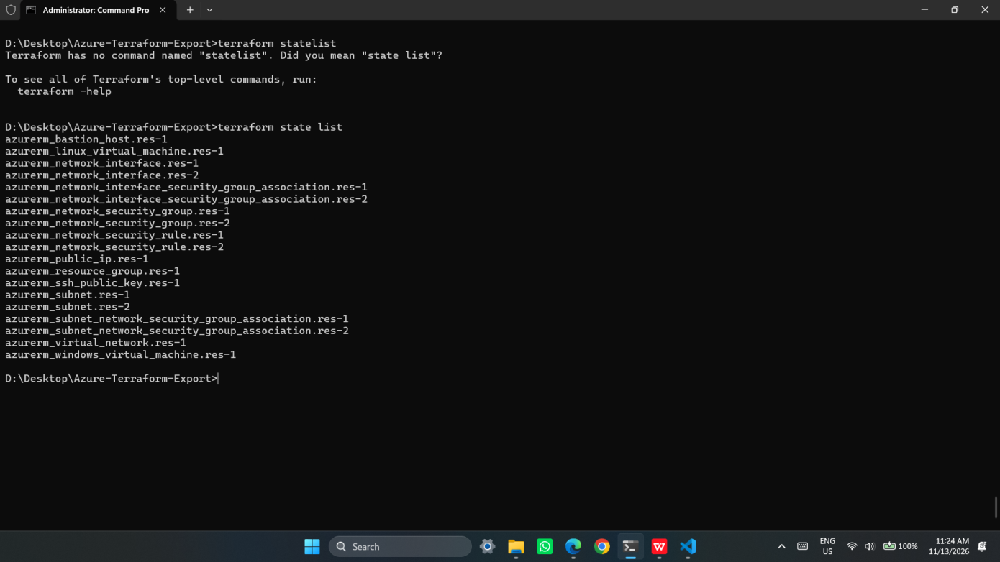

## Challenges and Troubleshooting

| Challenge | Solution |
|---|---|
| RDP access and Windows administrator password handling | Used a Terraform variable to provide the Windows password during deployment. |
| Conflicting generated VM configuration, including OS-managed disk ID references | Reviewed the generated Terraform code and removed the conflicting references. |
| Difficulties configuring Terraform | Used AI assistance while troubleshooting and reviewing the configuration. |

## Cleanup and Final Verification

The infrastructure was created and tested to verify deployment and connectivity. After confirming the expected network behaviour, the project infrastructure was deleted to avoid unnecessary Azure credit usage.

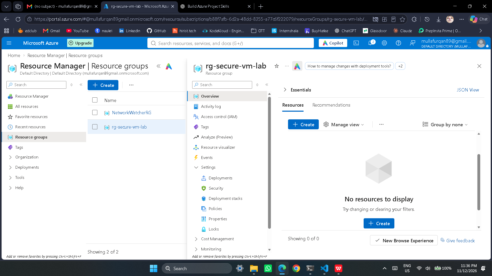

## Technologies Used

- Microsoft Azure
- Azure Virtual Machines
- Azure Virtual Network and subnets
- Network Security Groups
- Windows Server 2022
- Ubuntu Server 24.04 LTS
- Remote Desktop Protocol (RDP)
- Secure Shell (SSH)
- Terraform
- aztfexport

## Key Learnings

- Creating a virtual network and separating workloads into subnets.
- Using a Windows jump box to reach a private Linux VM.
- Restricting inbound access with NSG rules and source IP addresses.
- Testing successful and blocked connectivity paths.
- Exporting existing Azure resources with `aztfexport`.
- Reviewing Terraform configuration, state, and execution plans.
- Troubleshooting generated infrastructure code and cleaning up resources after testing.

## Project Demonstration

[Watch the project demonstration video](https://drive.google.com/file/d/1hU5i-Y37JRfG7rLjeSzK7pL3PZJ5QUz6/view?usp=sharing)

## Conclusion

This project demonstrated how a jump-box, separate subnets, and NSG rules can reduce direct exposure of private cloud resources. It also provided hands-on experience with Azure networking, VM connectivity testing, and Terraform automation using `aztfexport`.
